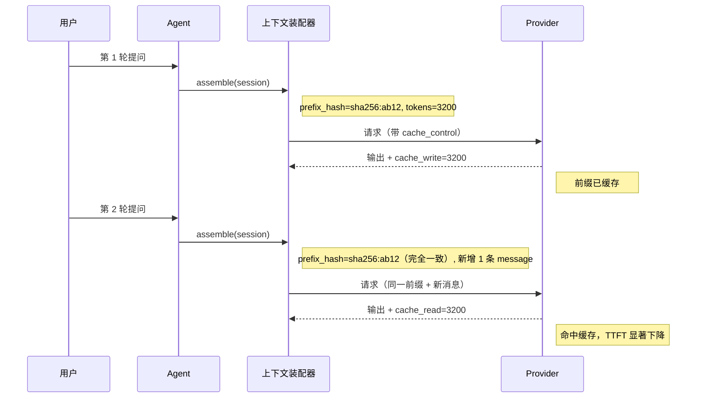
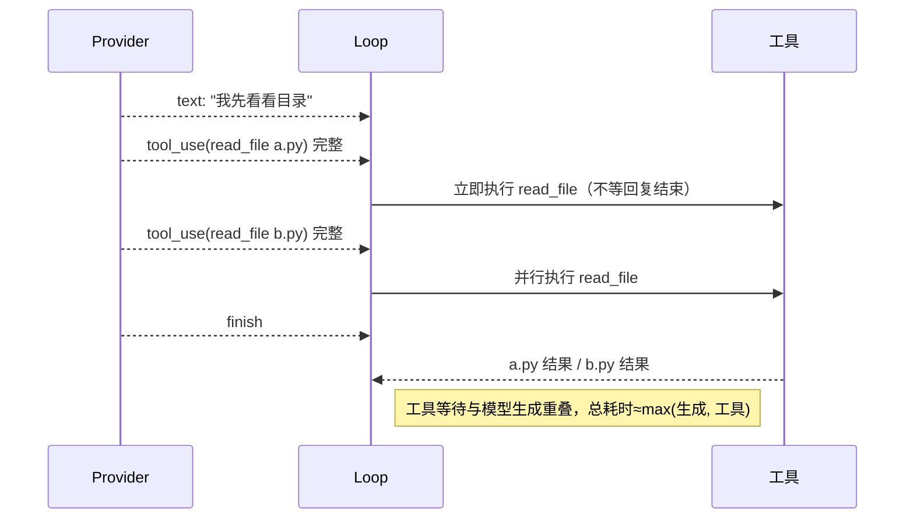
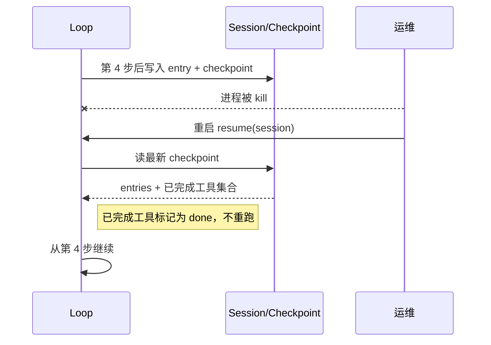

# Harness 融合框架 · 设计与讲解文档

> 面向使用者的框架讲解。核心问题只有一个：**同样是做 Agent，Harness 相比 AgentScope 2.0 / OpenClaw / LangGraph，到底强在哪、快在哪。**
>
> 参考三者源码（只读），全部用 Python 自研，不依赖 agentscope-python。

---

## 第零部分：核心竞争力（先看这个）

### 一句话定位

> **Harness 是一个「Prompt 缓存优先」的 Python Agent 运行时**：拿 LangGraph 的持久化循环、OpenClaw 的运行时效率机制、AgentScope 2.0 的抽象体系，拼成一个**长会话不烧钱、工具等待更短、崩了能续跑**的统一框架。

### 1. 能力矩阵：三个框架各自缺什么

| 能力 | AgentScope 2.0 | OpenClaw | LangGraph | **Harness** |
|------|:---:|:---:|:---:|:---:|
| ReAct 循环 + 工具调用 | ✅ | ✅ | ✅ | ✅ |
| 流式输出 | ✅ | ✅ | ✅ | ✅ |
| **流式重叠执行工具**（参数齐了就开跑，不等整条回复） | ❌ | ✅ | ❌ | ✅ |
| **并行只读工具 + 写工具串行准入** | ❌ | ✅ | ❌ | ✅ |
| **Prompt 前缀稳定 → 供应商缓存命中**（省钱降延迟） | ❌ | ✅ | ❌ | ✅ |
| 会话持久化 / 崩溃恢复 | 部分 | ✅ | ✅ | ✅ |
| **中途插话（steering）/ 强制中断** | 部分 | ✅ | ❌ | ✅ |
| **循环自愈**（工具重复 + 助手复读 + 轮次污染） | 部分 | ✅ | ❌ | ✅ |
| **上下文压缩且不破坏缓存前缀** | ❌ | ✅ | 部分 | ✅ |
| 权限 / HITL 人工确认 | ✅ | ✅ | ❌ | ✅ |
| 多模型抽象 + 能力探测（上下文窗口/缓存/结构化输出） | ✅ | 部分 | 部分 | ✅ |
| 事件体系（结构化全生命周期事件） | ✅ | ✅ | ❌ | ✅ |
| **Memory as Tool**（长期记忆包成工具给 LLM 调） | ✅ | ❌ | ❌ | ✅ |
| Skill 系统（SKILL.md 触发注入） | 部分 | ✅ | ❌ | ✅ |
| MCP 工具协议 | ✅ | ✅ | 部分 | ✅ |
| Gateway 多渠道 + 反向路由 | ❌ | ✅ | ❌ | ✅ |
| 可观测（Trace/Metrics/Log） | 部分 | ✅ | ❌ | ✅ |
| **训练数据采集 Hook（JSONL）** | ✅ | ✅ | ❌ | ✅ |

**结论**：没有任何一个框架同时具备上表全部能力。AgentScope 有抽象无运行时效率，OpenClaw 有运行时效率无统一抽象与 Memory，LangGraph 有持久化无运维面。

### 2. 「快」的定义：不是开发快，是跑起来快

| 指标 | AgentScope 2.0 | OpenClaw | LangGraph | **Harness 目标** |
|------|---------------|---------|-----------|------------------|
| 长会话第 N 轮 TTFT | 每轮重算全量前缀，随长度线性涨 | 命中缓存，基本恒定 | 同 AgentScope | **命中缓存时 p50 < 1.5s 且不随轮次上涨** |
| 长会话 token 成本 | 全量计费 | 命中缓存约省 80-90% | 全量计费 | **第 2 轮起缓存命中率 ≥ 80%** |
| 3 个独立只读工具耗时 | 串行 | 并行 | 串行 | **墙钟 ≈ max(t)，非 sum(t)** |
| 工具结果占上下文 | 原样塞回 | 截断 + 去重 | 原样塞回 | **单结果 ≤ 80KB，重复结果直接复用** |
| 崩溃恢复重跑 | 不支持 | 支持 | 支持 | **0 次工具重复执行** |
| 死循环烧钱 | 靠 max_iters 硬停 | 多层自愈 | 靠 recursion_limit | **工具重复/助手复读自动拦，不硬停** |

> 保守声明：Harness 用 Python，纯 CPU 吞吐不可能超过 TypeScript 的 OpenClaw。我们承诺的是**在 token 成本、工具等待、长会话延迟三项上不劣于 OpenClaw，并对 AgentScope / LangGraph 形成明显优势**。

### 3. 三条设计铁律（防止变成四不像）

1. **缓存优先**：任何会改动「已发给供应商的请求前缀」的行为都要有明确理由。系统提示、工具定义、历史消息**只追加、不改写**；压缩以「追加一条摘要 entry」的方式实现，而不是重写历史。
2. **小内核、大边缘**：模型供应商、渠道、Skill、Memory、MCP、插件都是**边缘适配器**，走统一接口；内核只保留 7 个部件（上下文装配、循环、工具执行、自愈、权限、会话、事件）。
3. **可度量**：每个能力必须有对应指标（缓存命中率、TTFT、工具墙钟、token 数、恢复重跑次数）。没有指标的能力不上线。

### 4. 明确不做（避免大杂烩）

- ❌ 自研 LLM SDK / 图执行引擎 / 向量数据库 / Web 前端
- ❌ RAG 全家桶（只保留「Memory as Tool」这一个接入口）
- ❌ 多租户计费、插件市场、模型训练平台
- ❌ 为了「支持某个框架的某个类」而复制它的类名

---

## 第一部分：术语表

| 术语 | 一句话解释 | 类比 |
|------|----------|------|
| **Agent** | 能接收消息、调工具、思考后回复的执行单元 | 被派去办事的助理 |
| **ReAct Loop** | 思考→调工具→看结果→再思考，直到能回答 | 侦探破案 |
| **StateGraph** | 用「节点+连线」描述执行流程的图 | 地铁线路图 |
| **Checkpoint** | 自动保存执行进度，崩溃可恢复 | 游戏自动存档 |
| **Prompt 前缀缓存** | 供应商把没变的前缀缓存起来，下轮直接复用，省 token 又降延迟 | 复印机记住原稿，下次只印改动页 |
| **前缀稳定（Prefix Stability）** | 会话内系统提示/工具定义/历史字节不变，只往后追加 | 试卷前面不许涂改，只能在最后加页 |
| **缓存断点（cache_control）** | 显式标记「从这里之前可以缓存」 | 在书里夹书签，告诉别人从这往前不用重读 |
| **流式重叠执行** | LLM 还在吐字时，参数已完整的工具就已经开跑 | 厨师边听点单边起锅，不等你说完 |
| **批次准入（Batch Admission）** | 判断哪些工具能并行、哪些必须串行 | 十字路口红绿灯 |
| **循环自愈（Loop Recovery）** | 检测「同一个工具反复调」「助手复读」并干预 | 导航发现你原地转圈，提醒你换路 |
| **轮次污染（Turn Taint）** | 某轮出现了失败/可疑结果，后续要隔离 | 一批货出了问题，整批要标记 |
| **会话 Entry（Session Entry）** | 会话历史是一条条不可变的 entry（消息/压缩/重置） | 银行流水，只能追加不能改 |
| **Compaction** | 上下文太长时把旧历史压成摘要 entry | 把厚账本整理成一页摘要，原件保留 |
| **HITL** | 危险操作前暂停，等人确认 | 转账要输支付密码 |
| **Middleware** | 贯穿请求链的横切逻辑（Onion/Transformer/Notification） | 快递经过每个站点都可加工 |
| **Hook** | 每个阶段前后一对的细粒度挂钩 | 考试每个环节都可记录 |
| **Skill** | SKILL.md 描述的按需能力包 | 手机 App |
| **Memory as Tool** | 把长期记忆包成工具，让 LLM 自己决定何时查 | 人脑主动「回忆」 |
| **MCP** | 标准化的 Agent 调外部工具协议 | USB 接口 |
| **ChannelAdapter** | 每种外部渠道的适配器 | 转换插头 |
| **ChannelRouter** | 决定消息交给谁、回复从哪发回去 | 公司总机 |
| **Steering** | 运行时中途插命令（插话/改配置/停止） | 乘客让司机掉头 |
| **Permission** | 判定允许/拒绝/需确认 | 门卫 |
| **Compaction Entry** | 压缩结果以追加 entry 形式落盘，不改历史 | 账本加一页「前 100 页摘要」 |
| **ReflectiveFunctionTool** | 从函数签名反射自动生成工具描述 | 填一次表格，系统自动识别 |
| **Tool Result Budget** | 工具结果的大小上限与去重策略 | 行李箱超重就压缩 |
| **Event** | 运行中产生的结构化事件 | 监护仪读数 |
| **OTel / Prometheus / structlog** | 追踪 / 指标 / 结构化日志 | 监护仪 / 仪表盘 / 小票 |

---

## 第二部分：框架全貌

### 8 层架构（含效率核心）

```
┌──────────────────────────────────────────────────────────────────────┐
│ 第 8 层  可观测（横切）                                                │
│   EventBus → OTel Trace / Prometheus（含 cache_hit_rate）/ structlog   │
└───────────────────────────────▲──────────────────────────────────────┘
                                │ 每个关键节点发 Event
┌──────────────────────────────────────────────────────────────────────┐
│ 第 7 层  Gateway（边缘，薄）                                           │
│   ChannelAdapter（WebChat 实装 / 飞书·MCP 壳+配置）→ ChannelRouter     │
│   → SteeringQueue（HTTP 入口）→ PluginSDK                              │
└───────────────────────────────┬──────────────────────────────────────┘
                                ▼
┌──────────────────────────────────────────────────────────────────────┐
│ 第 6 层  消息模型                                                      │
│   Msg + ContentBlock（text / thinking / image / tool_use / tool_result）│
└───────────────────────────────┬──────────────────────────────────────┘
                                ▼
┌──────────────────────────────────────────────────────────────────────┐
│ 第 5 层  Agent 接口层                                                  │
│   Agent = Callable + Streamable + Observable + Interruptible          │
│   ReActAgent（继承 AgentBase，依赖注入 model/toolkit/memory/...）       │
└───────────────────────────────┬──────────────────────────────────────┘
                                ▼
┌──────────────────────────────────────────────────────────────────────┐
│ ★ 第 4.5 层  上下文装配器（Context Assembler）—— 效率核心 ★             │
│   ├─ 稳定前缀：system prompt + tool schema（会话内字节不变）            │
│   ├─ 追加历史：messages 只 append，不改写                              │
│   ├─ 易变上下文：本轮临时信息单独承载，不进缓存前缀                      │
│   ├─ 缓存断点：按 Provider 能力打 cache_control / prompt_cache_key      │
│   └─ Token 预算：超阈值触发 Compaction（追加 entry，不改历史）           │
└───────────────────────────────┬──────────────────────────────────────┘
                                ▼
┌──────────────────────────────────────────────────────────────────────┐
│ 第 4 层  Model 适配（薄）                                              │
│   Model.stream(messages, tools, options) + 能力探测                    │
│   （context_window / cache_profile / supports_structured）             │
│   供应商：OpenAI 兼容 / Anthropic / Ollama（边缘插件）                  │
└───────────────────────────────┬──────────────────────────────────────┘
                                ▼
┌──────────────────────────────────────────────────────────────────────┐
│ 第 3 层  Tool + Memory（能力面）                                       │
│   Tool：ReflectiveFunctionTool + Registry + ResultBudget（截断/去重）   │
│   Memory：InMemory / AgentStateView / LongTerm → 包装成 Tools          │
└───────────────────────────────┬──────────────────────────────────────┘
                                ▼
┌──────────────────────────────────────────────────────────────────────┐
│ 第 2 层  Loop 引擎（核心）                                             │
│   StateGraph：assemble → model(流式) → 重叠执行工具 → 自愈 → finalize   │
│   并行执行（只读并行/写串行）· Steering · Interrupt · 轮次污染追踪      │
└───────────────────────────────┬──────────────────────────────────────┘
                                ▼
┌──────────────────────────────────────────────────────────────────────┐
│ 第 1 层  会话与治理                                                    │
│   Session Entry（message/compaction/reset）→ 派生上下文窗口            │
│   Checkpoint 恢复 · Permission（5 模式）· HITL · 扩展点（MW/Hook）     │
└──────────────────────────────────────────────────────────────────────┘
```

### 数据流总览

```
外部消息 → Gateway → 消息模型 → Agent → 上下文装配器（打缓存断点）
        → Model 流式 → 工具重叠/并行执行 → 自愈检查 → 回到装配器
        → finalize → Agent → Gateway 反向路由 → 外部渠道
                              ↘ Event → OTel / Prometheus / Log
                              ↘ Session Entry 追加 → Checkpoint
```

---

## 第三部分：部件详解

### 部件 0：上下文装配器（Context Assembler）★效率核心

| 要素 | 内容 |
|------|------|
| **是什么** | 每次调模型前，把「系统提示 + 工具定义 + 历史 + 本轮临时上下文」装配成请求体的唯一入口。 |
| **干什么** | 保证**稳定部分字节不变**，让供应商前缀缓存命中；同时执行 token 预算与压缩触发。 |
| **前关联** | ReAct Loop 的 `assemble` 节点 |
| **后关联** | Model.stream()、Compaction、Session Entry |
| **为什么强/快** | AgentScope / LangGraph 每轮重建上下文导致缓存必然 miss；Harness 显式分层后，长会话成本与 TTFT 基本恒定。OpenClaw 有该机制，Harness 在实现上对齐并在压缩时不破坏前缀。 |

**装配结果 JSON**

```jsonc
{
  "stable_prefix": {                     // 会话内字节不变
    "system_prompt": "你是一个编码助手...",
    "tool_schemas": [ /* 工具定义，顺序与内容固定 */ ],
    "prefix_hash": "sha256:ab12..."      // 用于断言两轮前缀一致
  },
  "history": [ /* 只追加的 Msg 列表 */ ],
  "volatile_context": {                  // 本轮临时信息，不进缓存前缀
    "current_time": "2026-11-06T10:00:00+08:00",
    "steering_notes": []
  },
  "cache_hints": {
    "provider": "anthropic",
    "breakpoints": [                     // 缓存断点
      { "after": "stable_prefix", "ttl": "1h" },
      { "after": "history[-2]", "ttl": "5m" }
    ]
  },
  "token_budget": {
    "max_context_tokens": 32000,
    "current_tokens": 8421,
    "compaction_required": false
  }
}
```

**缓存断点策略（按供应商能力）**

| 供应商 | 缓存机制 | Harness 做法 |
|--------|---------|-------------|
| Anthropic | 显式 `cache_control: {type:"ephemeral", ttl}` | 系统提示 + 工具定义一个断点；最近两处历史各一个（上限 4 个） |
| OpenAI | 自动前缀缓存 + `prompt_cache_key` | session 级稳定 key；前缀需 ≥1024 token 才可能命中 |
| DeepSeek | **全自动**块级缓存，无任何参数（命中价约为未命中 1/10） | 不传参数，**唯一手段就是前缀字节稳定**；按 64 token 块对齐 |
| 通义 / Kimi / GLM / 豆包 | OpenAI 兼容，多为自动缓存 | 同上；不假设存在 `cache_control` |
| 本地（Ollama / vLLM） | 取决于部署，可关闭 | 前缀稳定照做，对 KV Cache / Prefix Caching 同样有效 |

> **关键判断**：绝大多数国产模型是「自动缓存」，**没有 cache_control 可打**。所以 Harness 的效率不依赖某家供应商的特性，而依赖「装配器保证前缀字节不变」这一个动作——这才是能跨供应商复用的机制。

**前缀稳定性守卫（Prefix Guard）**

装配器每次装配后计算 `prefix_hash`，与上一次比对。前缀变化必须命中白名单原因，否则开发模式直接抛错：

| 允许前缀变化的原因 | 说明 |
|---|---|
| `session_start` | 新会话 |
| `toolset_changed` | 工具集变化（如刚接入 MCP Server）→ 提示开新会话 |
| `compaction_applied` | 压缩后重建窗口（一次性） |
| `model_switched` | 换模型（缓存本来就按模型隔离） |
| `config_reloaded` | 系统提示配置显式重载 |

**明确禁止进入 stable_prefix 的内容**（每一条都会让该点之后的缓存全部失效）：

- 当前时间戳 / 随机 ID / 请求计数器
- 未排序的工具定义（必须按注册顺序或名称稳定排序）
- 每轮变化的 Memory 检索结果（只能作为工具结果进 history）
- 每轮重新生成的 Skill 列表（见部件 11 的追加式注入）

**怎么度量（含供应商不返回 usage 的情况）**

| 供应商行为 | 度量方式 |
|---|---|
| 返回 `cache_read_tokens` | `cache_hit_ratio = cache_read_tokens / input_tokens`（首选） |
| 只返回 `cached_tokens`（OpenAI 风格） | 映射到同一字段后按上式计算 |
| 完全不返回 | `cache_hit_ratio_estimated = 命中前缀长度 / 总输入长度`（由 `prefix_hash` 是否与上轮相同判定），并用「第 2 轮 TTFT 是否显著低于第 1 轮」交叉验证 |

**验收**：连续两轮请求 `prefix_hash` 一致；供应商返回缓存字段时 `cache_read_tokens > 0`；不返回时 `cache_hit_ratio_estimated ≥ 0.8` 且第 2 轮 TTFT 明显低于第 1 轮。

---

### 部件 1：统一消息模型 + ContentBlock

| 要素 | 内容 |
|------|------|
| **是什么** | 全链路统一消息结构，content 为 ContentBlock 数组。 |
| **干什么** | 承载多模态与工具调用，保证序列化稳定（影响缓存）。 |
| **前关联** | Gateway 适配器、上下文装配器 |
| **后关联** | Model、Tool、Session Entry |

**精简的块类型（先做 5 种，其余按需扩展）**

| block_type | 用途 | 关键字段 |
|---|---|---|
| `text` | 文本 | `text` |
| `thinking` | 思维链 | `text` |
| `image` | 图片 | `source{source_type,data}` |
| `tool_use` | 模型请求调工具 | `tool_name, args, tool_call_id` |
| `tool_result` | 工具结果 | `tool_call_id, content, is_error` |

> 说明：AgentScope 有 10 种 block，但真实业务 95% 只用这 5 种。其余（video/audio/document/hint/data）留接口，不做实现——这是「不强求对齐」。

```jsonc
{
  "id": "msg_a1b2",
  "role": "assistant",
  "name": null,
  "content": [
    { "block_type": "text", "text": "我来查一下" },
    { "block_type": "tool_use", "tool_name": "bash",
      "args": {"command": "date"}, "tool_call_id": "call_1" }
  ],
  "metadata": {"session_id": "sess_abc"},
  "timestamp": 1730800000.123,
  "usage": { "input_tokens": 820, "output_tokens": 45, "cache_read_tokens": 640 }
}
```

---

### 部件 2：Gateway（边缘，接口 + 壳 + 配置）

| 要素 | 内容 |
|------|------|
| **是什么** | 对外渠道适配与路由层。按你的要求：**WebChat 实装，其余做完整接口 + 壳 + 配置**。 |
| **干什么** | 入站：原始消息→统一 Msg→路由到 Agent；出站：回复→反向路由回原渠道（或回复到指定渠道）。 |
| **前关联** | 外部渠道（WebSocket/Webhook/stdio/cron） |
| **后关联** | SteeringQueue、Agent |

```python
class ChannelAdapter(ABC):
    name: str
    async def connect(self) -> None: ...
    async def receive(self) -> list[RawMessage]: ...
    async def send(self, msg: Msg) -> SendResult: ...
    async def close(self) -> None: ...
```

```jsonc
// 配置驱动加载（飞书等只需填配置启用）
{
  "channels": [
    {"name": "webchat", "type": "builtin.webchat", "enabled": true, "port": 8000},
    {"name": "feishu",  "type": "builtin.feishu",  "enabled": false,
     "app_id": "${FEISHU_APP_ID}", "app_secret": "${FEISHU_APP_SECRET}"},
    {"name": "mcp_stdio", "type": "builtin.mcp_stdio", "enabled": false,
     "command": ["python", "-m", "my_mcp_server"]}
  ]
}
```

> 飞书 / MCP stdio 只提供壳（实现 connect/receive/send 骨架 + 配置校验），启用后按配置生效。

**出站反向路由 JSON**

```jsonc
{
  "session_id": "sess_oc_xxx",
  "reply_msg": { /* AssistantMessage */ },
  "reply_channel": { "adapter": "feishu", "chat_id": "oc_def456" }
}
```

---

### 部件 3：Agent 接口层 + ReActAgent

| 要素 | 内容 |
|------|------|
| **是什么** | Agent 是四合一契约（Callable / Streamable / Observable / Interruptible），ReActAgent 是具体实现。 |
| **干什么** | 对外统一 call / stream / subscribe / interrupt。 |
| **前关联** | Gateway、SteeringQueue |
| **后关联** | 上下文装配器、Loop、EventBus |
| **来源** | AgentScope 2.0 `agent/Agent.java` + `ReActAgent.java` 的依赖注入设计 |

```python
class Agent(ABC):
    async def call(self, msgs: list[Msg]) -> Msg: ...
    async def call_stream(self, msgs: list[Msg]) -> AsyncIterator[Event]: ...
    def subscribe(self, event_type: EventType, handler) -> None: ...
    def interrupt(self, reason: str) -> None: ...

class ReActAgent(AgentBase):
    def __init__(self, *, sys_prompt, model, toolkit, memory, permission,
                 hooks=None, middlewares=None, max_steps=20): ...
```

> 依赖注入的意义：换模型、换工具集、换记忆、加 Hook，都不用改 Agent 代码。

---

### 部件 4：Model 适配（薄）+ 能力探测

| 要素 | 内容 |
|------|------|
| **是什么** | 统一 `stream()` 契约 + 能力探测。 |
| **干什么** | 抹平供应商差异；告诉上层「能不能缓存、窗口多大、能否结构化输出」。 |
| **前关联** | 上下文装配器 |
| **后关联** | 供应商 API |
| **来源** | AgentScope 2.0 `model/Model.java`（能力查询），但**不做 40 个文件的传输层**，只保留 httpx 一套 |

```python
class Model(ABC):
    async def stream(self, messages, tools, options) -> AsyncIterator[ChatChunk]: ...
    @property
    def context_window(self) -> int: ...
    @property
    def cache_profile(self) -> CacheProfile: ...   # 装配器据此决定打不打断点
    def supports_structured_output(self) -> bool: ...
    def supports_tool_choice(self) -> bool: ...
```

**CacheProfile（装配器的输入，不是模型的装饰）**

| 字段 | 含义 | 装配器怎么用 |
|------|------|-------------|
| `mode` | `explicit` / `automatic` / `none` | explicit → 打 `cache_control`；automatic → 只保前缀稳定 |
| `min_cacheable_tokens` | 低于此长度不缓存（OpenAI 1024、DeepSeek 按块） | 前缀太短时不必强求稳定，省钱无意义 |
| `max_breakpoints` | 最多几个断点（Anthropic 4） | 超了就合并断点 |
| `ttl_options` | 支持的 TTL 档位 | 选择 5m / 1h |
| `reports_cache_usage` | 是否返回 `cache_read_tokens` | 决定用真实指标还是估算指标 |

> 这一层是相对 OpenClaw 的**实质增强**：OpenClaw 的缓存策略主要面向 Anthropic / OpenAI 两家；Harness 把「自动缓存」纳入同一套装配逻辑，才能在国内模型上真正省钱。

> 为什么这是「强」：AgentScope 有这套能力查询但缺运行时；OpenClaw 运行时强但模型能力抽象弱。Harness 两者都要。

---

### 部件 5：Tool 系统（反射生成 + 结果预算）

| 要素 | 内容 |
|------|------|
| **是什么** | `@tool` 装饰器从函数签名反射生成工具；执行时对结果做截断与去重。 |
| **干什么** | 降低接入成本；控制结果占用的上下文（直接影响成本）。 |
| **前关联** | Loop 的 execute 节点 |
| **后关联** | 真实工具 / MCP |
| **来源** | AgentScope `ReflectiveFunctionTool`；OpenClaw 的结果处理 |

```python
@tool(name="bash", description="在工作目录执行命令")
async def bash(command: str, timeout: int = 30) -> str: ...
# 反射自动得到 parameters: {command: string(required), timeout: integer(default 30)}
```

**Tool Result Budget 规则**

| 规则 | 值 | 作用 |
|------|-----|------|
| 单结果字符上限 | 80,000 | 防上下文爆炸 |
| 超限处理 | 头尾保留 + 中间标记省略 | 保留可判断信息 |
| 相同 `tool+args` 结果 | 命中缓存直接复用，不重复执行 | 省时间省 token |
| 相同结果再次入上下文 | 只保留首次 + 引用 | 省 token |

```jsonc
// 截断后的 ToolResultBlock
{
  "block_type": "tool_result",
  "tool_call_id": "call_1",
  "is_error": false,
  "content": "前 40000 字...\n\n[... 省略 120000 字 ...]\n\n...后 40000 字",
  "metadata": {"truncated": true, "original_chars": 200000, "cache_hit": false}
}
```

---

### 部件 6：Loop 引擎 + 流式重叠

| 要素 | 内容 |
|------|------|
| **是什么** | LangGraph StateGraph 驱动的 ReAct 循环，工具在流式过程中重叠执行。 |
| **干什么** | 决定「什么时候想、什么时候做、什么时候结束」。 |
| **前关联** | Agent |
| **后关联** | 上下文装配器、Tool、自愈、Event |
| **来源** | OpenClaw `agent-loop.ts`（嵌套双层循环 + 流中执行工具），骨架用 LangGraph |

**循环结构（对齐 OpenClaw 的真实形态）**

```python
while True:                                   # 外层：一次用户请求
    has_more_tool_calls = first_turn
    while has_more_tool_calls or pending_steering:
        if aborted(): break
        # 1) 处理中途插话
        inject_pending_steering()
        # 2) 装配上下文（缓存感知）
        request = context_assembler.assemble(state)
        # 3) 流式调模型，并在流中重叠执行工具
        async for chunk in model.stream(request):
            emit(chunk)
            for call in chunk.completed_tool_calls:
                schedule_overlapped_tool(call)   # 参数齐了就开跑
        # 4) 执行剩余/异步工具
        batch = await execute_remaining_tools()
        # 5) 自愈检查
        recovery = loop_recovery.inspect(batch, assistant_msg)
        # 6) 追加 session entry + checkpoint
        append_entries_and_checkpoint()
        # 7) 判断是否继续
        has_more_tool_calls = batch.terminate is False
        pending_steering = batch.steering_messages
        if recovery.terminate_run: return terminate(recovery)
```

**为什么快**：串行实现 = `LLM 完整输出 + 全部工具`；重叠实现 = `LLM 输出与工具执行取并集`，问题规模越大差距越明显。

---

### 部件 7：并行工具 + 循环自愈 + 轮次治理

三个机制合并在一个部件族里，因为它们在 Loop 里耦合。

**7.1 批次准入（Parallel）**

| 工具类别 | 并行策略 |
|---------|---------|
| 只读（read_file/search/http_get） | 全并行，上限 N |
| 写（write_file/bash_rm/mv） | 同组串行 |
| 网络 | 独立组，可并行 |

```jsonc
{
  "batches": [
    {"batch_id": 1, "mode": "parallel",
     "calls": [{"name":"read_file","args":{"path":"a.py"}},
               {"name":"search","args":{"q":"TODO"}}]},
    {"batch_id": 2, "mode": "sequential", "waits_for": "batch_1",
     "calls": [{"name":"write_file","args":{"path":"a.py"}}]}
  ]
}
```

**7.2 循环自愈（对齐 OpenClaw 三层）**

| 层 | 检测 | 干预 |
|----|------|------|
| 工具重复 | 同一 `tool+args` 已执行过 | 不执行，返回「已执行过，结果在上方」 |
| 工具连续报错 | 同一工具连续失败 N 次 | 追加诊断提示，禁止继续重试该工具 |
| 助手复读 | 连续两条 assistant 内容高相似 | 注入「你已重复」，强制换路 |
| 终止 | 上述无效 | `terminate_run`，返回明确失败原因（不静默烧 token） |

**7.3 轮次污染（Turn Taint）**

```jsonc
{
  "turn": 4,
  "tainted": true,
  "reasons": ["tool_error:bash", "steering_injected"],
  "effect": "后续 summarize 与 memory 写入需标记该轮不可信"
}
```

---

### 部件 8：会话 Entry + Checkpoint

| 要素 | 内容 |
|------|------|
| **是什么** | 会话历史是**不可变 entry 序列**，不是可变 message 数组。 |
| **干什么** | 压缩/重置以「追加 entry」表达，天然保住缓存前缀；配合 checkpoint 支持崩溃续跑。 |
| **前关联** | Loop、Compaction |
| **后关联** | 上下文装配器、存储（SQLite） |
| **来源** | OpenClaw `harness/session/session.ts`（`SessionTreeEntry` + `firstKeptEntryId`）；持久化用 LangGraph checkpoint |

**Entry 类型**

| type | 含义 | 关键字段 |
|------|------|---------|
| `message` | 一条消息 | `message` |
| `compaction` | 压缩摘要 | `summary, first_kept_entry_id, tokens_before` |
| `reset` | 重置点 | — |
| `custom` | 自定义（如失败回执） | `custom_type, content, exclude_from_context` |

**上下文窗口派生**：找最后一个 `compaction`/`reset` entry 作为边界，从它的 `first_kept_entry_id` 开始保留。

```jsonc
{
  "entries": [
    {"id":"e1","type":"message","message":{/*...*/}},
    {"id":"e2","type":"message","message":{/*...*/}},
    {"id":"e3","type":"compaction","summary":"前文摘要...",
     "first_kept_entry_id":"e2","tokens_before":18420},
    {"id":"e4","type":"message","message":{/*...*/}}
  ],
  "effective_context": ["e2","e3","e4"]
}
```

**恢复**：`resume(session_id, from_step=None)` → 读最新 checkpoint → 校验已完成工具调用 → 继续，**不重跑已完成的工具**。

---

### 部件 9：Permission + HITL

| 要素 | 内容 |
|------|------|
| **是什么** | 工具调用前的权限判定 + 需确认时的人工闸门。 |
| **干什么** | 危险操作可拦、可问、可放。 |
| **前关联** | Loop 的 execute 节点 |
| **后关联** | HITL 存储、Gateway 通知 |
| **来源** | AgentScope `permission/`（5 模式 + 判定链） |

| 模式 | 只读 | 写文件 | 执行命令 |
|------|:---:|:---:|:---:|
| DEFAULT | ✅ | 询问 | 询问 |
| ACCEPT_EDITS | ✅ | ✅ | 询问 |
| EXPLORE | ✅ | ❌ | ❌ |
| BYPASS | ✅ | ✅ | ✅ |
| DONT_ASK | ✅ | ✅ | ✅（静默） |

判定链：`BYPASS/DONT_ASK → 自定义规则 → 模式默认`。

```jsonc
{"behavior":"ASK","reason":"git push 需确认",
 "hitl":{"hitl_id":"hitl_1","options":["允许","拒绝","始终允许"],
         "state_ref":"checkpoint:sess_abc:step4"}}
```

HITL 挂起期间 Loop 完全暂停，状态已在 checkpoint，进程可重启。

---

### 部件 10：Compaction（追加式，不破坏缓存）

| 要素 | 内容 |
|------|------|
| **是什么** | 上下文超阈值时生成摘要，以 `compaction` entry 追加。 |
| **干什么** | 控制 token 上限，同时**不改写已缓存前缀**。 |
| **前关联** | 上下文装配器的 token 预算 |
| **后关联** | Session Entry、摘要模型 |
| **来源** | OpenClaw `compaction.ts`（`{summary, firstKeptEntryId, tokensBefore}` + 16K 摘要硬上限） |

```jsonc
{
  "summary": "用户要求分析销售数据：已查 1000 条，华东 40%/华北 30%/华南 20%/其他 10%...",
  "first_kept_entry_id": "e42",
  "tokens_before": 41230,
  "tokens_after": 6800,
  "summary_chars": 4820,
  "max_summary_chars": 16000
}
```

> 关键：摘要长度硬上限 16K；压缩后上下文从 `first_kept_entry_id` 开始，之前的内容由摘要代表。**不修改已有 entry**。

**压缩的成本账（不写清楚就会误判「变慢」）**

| 时点 | 发生什么 | 成本 / 延迟 |
|------|---------|------------|
| 第 N 轮触发压缩 | 摘要请求复用**同一缓存前缀**，只在尾部追加「请总结」指令 | ≈ 0.1× 全量成本（前缀命中） |
| 压缩后第 1 轮 | 前缀必然重建（窗口起点变了），缓存 miss | TTFT 回到首轮水平，仅一次 |
| 压缩后第 2 轮起 | 新前缀稳定，再次命中 | 恢复正常 |

> 所以压缩的代价是「一次性」，不是「每轮都慢」。阈值取上下文窗口的 80%-85% 以免频繁触发；**摘要请求必须走上下文装配器**，禁止绕过去裸调模型（绕过就等于付全价）。

---

### 部件 11：Skill 系统（追加式注入）

| 要素 | 内容 |
|------|------|
| **是什么** | SKILL.md（YAML frontmatter + Markdown）描述的能力包，四层合成。 |
| **干什么** | 按触发词注入专业提示与绑定工具。 |
| **前关联** | 会话开始 / 用户消息 |
| **后关联** | 上下文装配器的 stable_prefix |
| **来源** | OpenClaw SKILL.md；四层优先级 |

```markdown
---
name: "code-reviewer"
description: "代码审查专家"
triggers: ["审查代码", "review pr"]
tools_binding: ["read_file", "git_diff"]
---
# 代码审查专家
按正确性、安全、可维护性逐项检查...
```

四层：用户 `~/.harness/skills` > 项目 `./skills` > 远程仓库 > 内置。

**注入方式：追加式，而不是改写系统提示**

| 做法 | 前缀影响 | 结论 |
|------|---------|------|
| 把 Skill 正文拼进 system prompt | 每次换 Skill 都要重建整个前缀 | ❌ 不用 |
| 把 Skill 正文作为 `custom_message` entry **追加**到历史尾部 | 前缀不变，只新增尾部内容 | ✅ 采用 |

```jsonc
// 会话中途激活 Skill 时追加的 entry（不进 stable_prefix）
{
  "type": "custom_message",
  "custom_type": "harness.skill",
  "content": "<skill name=\"code-reviewer\">...正文...</skill>",
  "timestamp": 1730800123.0
}
```

**唯一需要重建前缀的情况**：Skill 绑定了尚未注册的新工具（`tools_binding` 非空）。这时才提示「需新会话」，并在事件中标记 `toolset_changed`。

> 这样用户可以在同一会话里说「现在用代码审查模式」，而不付一次全量重算的代价——相对「首轮锁定 Skill」是实质改进。

---

### 部件 12：Memory as Tool

| 要素 | 内容 |
|------|------|
| **是什么** | 长期记忆包装成工具，由 LLM 自己决定何时检索/保存。 |
| **干什么** | 跨会话记忆；不给框架加特殊逻辑。 |
| **前关联** | Toolkit |
| **后关联** | SQLite（+ 可选向量检索） |
| **来源** | AgentScope `LongTermMemoryTools` |

```python
@tool(name="memory_search", description="搜索历史记忆")
async def memory_search(query: str, top_k: int = 5) -> str: ...

@tool(name="memory_save", description="保存重要信息到长期记忆")
async def memory_save(content: str, tags: list[str] = []) -> str: ...
```

> 不做完整 RAG：只做「检索/写入」两个工具。向量库是可选依赖，默认关键词 + 时间排序。

---

### 部件 13：MCP 接入

| 要素 | 内容 |
|------|------|
| **是什么** | 通过 JSON-RPC 调用任意 MCP Server 的工具。 |
| **干什么** | 复用生态工具，不用重写。 |
| **前关联** | Toolkit（`add_from_mcp`） |
| **后关联** | MCP Server（stdio / HTTP） |

```jsonc
{"jsonrpc":"2.0","id":1,"method":"tools/call",
 "params":{"name":"weather","arguments":{"city":"北京"}}}
```

---

### 部件 14：Event + 可观测性

| 要素 | 内容 |
|------|------|
| **是什么** | 结构化事件 → Trace / Metrics / Log。 |
| **干什么** | 让「快」可度量、故障可定位。 |

**事件类型（精简 10 种）**：`agent_start/end`、`model_call_start/end`、`text_delta`、`tool_call`、`tool_result`、`hitl_required/resolved`、`error`。

**必须暴露的指标**

| 指标 | 类型 | 用途 |
|------|------|------|
| `harness_cache_hit_ratio` | Gauge | 缓存命中率（核心） |
| `harness_ttft_seconds` | Histogram | 首字延迟 |
| `harness_tool_wall_seconds` | Histogram | 工具墙钟 |
| `harness_tokens_total{kind}` | Counter | 输入/输出/缓存读 |
| `harness_loop_recovery_total{reason}` | Counter | 自愈触发次数 |
| `harness_resume_replayed_tools` | Counter | 恢复时重跑工具数（应为 0） |

---

### 部件 15：扩展点（Middleware + Hook + Plugin）

| 扩展点 | 粒度 | 用途 |
|--------|------|------|
| **Middleware** | 贯穿请求链（Onion/Transformer/Notification） | 压缩、权限、Skill 注入、答案过滤 |
| **Hook** | 每阶段一对（Pre/Post Reasoning / Acting / Call / Summary） | 埋点、训练数据 JSONL、输出校验 |
| **Plugin** | 运行时加载 | 新渠道、新权限规则、新 Skill 包 |

```python
class Hook(ABC):
    event_type: HookEventType
    async def execute(self, event: HookEvent) -> None: ...

class JsonlTraceExporter(Hook):
    """把每阶段 state+input+output 追加到 .jsonl，供 SFT 训练用。"""
```

> 三者是「边缘」，不是内核。内核不依赖任何具体扩展。

---

## 第四部分：数据流转（三个关键场景）

### 场景 A：长会话缓存命中（体现「快」）



**第 2 轮 token 计费对比**

```jsonc
{
  "round": 2,
  "without_cache": {"input_tokens": 3600, "cost_relative": 1.00},
  "with_cache":    {"input_tokens": 3600, "cache_read_tokens": 3200,
                    "cost_relative": 0.14},
  "ttft_ms": {"without_cache": 2100, "with_cache": 720}
}
```

### 场景 B：流式重叠执行（体现「快」）



### 场景 C：崩溃恢复（体现「强」）



**恢复结果**

```jsonc
{
  "resumed": true,
  "from_step": 4,
  "replayed_tools": 0,
  "skipped_completed_tools": ["call_1", "call_2", "call_3"]
}
```

---

## 第五部分：业务场景

### 场景 1：企业编码助手（飞书 / WebChat）

| 问题 | Harness 对应 | 效果 |
|------|-------------|------|
| 长对话越来越贵 | 上下文装配器 + 缓存断点 + Compaction | 第 2 轮起成本降 ~80% |
| Agent 反复读同一文件 | 循环自愈 + 结果去重 | 不重复烧 token |
| 用户改主意 | Steering 插话 | 下一轮立即生效 |
| 危险命令 | Permission + HITL | git push 前必须确认 |
| 进程重启丢进度 | Session Entry + Checkpoint | 0 重跑恢复 |

### 场景 2：数据分析助手（只读）

| 问题 | Harness 对应 | 效果 |
|------|-------------|------|
| 10 条查询串行太慢 | 只读工具并行准入 | 墙钟≈最慢一条 |
| 上下文爆炸 | Tool Result Budget + Compaction | 稳定在阈值内 |
| 误改数据 | Permission=EXPLORE | 写操作直接拒绝 |
| 需要复盘 | Event + OTel + JSONL Hook | 全链路可追溯 |

### 场景 3：运维自动化（定时 + 无人值守）

| 问题 | Harness 对应 | 效果 |
|------|-------------|------|
| 半夜崩了没人管 | Checkpoint 恢复 | 自动续跑 |
| 重启服务要人拍板 | HITL + 渠道通知 | 值班确认后继续 |
| 疑似死循环 | 三层自愈 + terminate | 明确失败，不静默烧钱 |
| 要事后审计 | Session Entry（不可变）+ Trace | 完整流水 |

### 场景 4：MCP 工具接入

| 步骤 | 数据 |
|------|------|
| 注册 | `toolkit.add_from_mcp(client)` → tools/list |
| 调用 | LLM 产出 tool_use → ToolExecutor → JSON-RPC → tool_result |
| 治理 | Permission 对 MCP 工具与内置工具一视同仁 |

---

## 附录 A：能力 × 框架 明细（对应能力 → 实现选择）

| # | 能力 | Harness 实现 | 是否自研 | 来源 |
|---|------|-------------|:---:|------|
| 1 | 消息 + ContentBlock | Pydantic | ✅ | AgentScope |
| 2 | 上下文装配 + 缓存 | 自研 | ✅ | OpenClaw prompt-caching |
| 3 | Model 适配 + 能力探测 | httpx | ✅ | AgentScope + 精简 |
| 4 | Reflective 工具 | inspect | ✅ | AgentScope |
| 5 | 结果预算（截断/去重） | 自研 | ✅ | OpenClaw |
| 6 | ReAct Loop | LangGraph | 复用 | LangGraph + OpenClaw |
| 7 | 流式重叠执行 | 自研 | ✅ | OpenClaw |
| 8 | 并行准入 | 自研 | ✅ | OpenClaw |
| 9 | 循环自愈（三层） | 自研 | ✅ | OpenClaw |
| 10 | 轮次污染 | 自研 | ✅ | OpenClaw |
| 11 | Session Entry | 自研 | ✅ | OpenClaw |
| 12 | Checkpoint 恢复 | LangGraph | 复用 | LangGraph |
| 13 | Permission + HITL | 自研 | ✅ | AgentScope |
| 14 | Compaction | 自研 | ✅ | OpenClaw |
| 15 | Skill | 自研 | ✅ | OpenClaw |
| 16 | Memory as Tool | 自研 | ✅ | AgentScope |
| 17 | MCP | 自研 | ✅ | MCP 规范 |
| 18 | Event + 可观测 | OTel/Prometheus/structlog | 复用 + 封装 | 标准 |
| 19 | Middleware / Hook | 自研 | ✅ | AgentScope |
| 20 | Plugin | importlib | ✅ | OpenClaw |

---

## 附录 B：性能目标与度量方法

| 指标 | 目标 | 怎么测 |
|------|------|--------|
| 缓存命中率 | ≥ 80%（第 2 轮起） | provider 返回 `cache_read_tokens / input_tokens` |
| 缓存命中率（不返回 usage 时） | ≥ 80% 估算 | `prefix_hash` 命中长度 / 总长度 + 跨轮 TTFT 对比 |
| TTFT（命中缓存） | p50 < 1.5s | 从发请求到首个 text_delta |
| 3 只读工具墙钟 | ≤ 1.3 × 单工具 | 对比串行 vs 并行 |
| 50 轮上下文 | < 32k token 且不随轮次涨 | 记录每轮 `input_tokens` |
| 恢复重跑 | 0 次 | `harness_resume_replayed_tools == 0` |
| 死循环止损 | ≤ max_steps 次模型调用 | `harness_loop_recovery_total` |
| 任务成功率（防「快但错」） | ≥ 90%（10 条固定任务） | `tests/eval_tasks.jsonl` 逐条跑，断言工具序列与答案要点 |

> 每个 Phase 的验收都引用这里的指标，而不是只写「PASS」。

---

**文档版本**：v2.1（自审修订）
**最后更新**：2026-11-06
**配套文档**：`docs/implementation-roadmap.md`
